# Guide du rédacteur — site de l'Université Adventiste Zurcher

Ce guide s'adresse aux personnes qui **publient et mettent à jour** le site : actualités, pages, images, événements.
Aucune connaissance technique n'est nécessaire. Comptez 15 minutes pour le lire en entier.

> **Les captures d'écran** de ce guide sont dans `docs/screenshots/` (régénérables avec `node tests/e2e/admin-shots.mjs`).

---

## 1. Se connecter

1. Ouvrez l'adresse du back-office : **`https://zurcher.edu.mg/admin`**.
2. Saisissez votre **adresse e-mail** et votre **mot de passe**, puis cliquez sur *Connexion*.

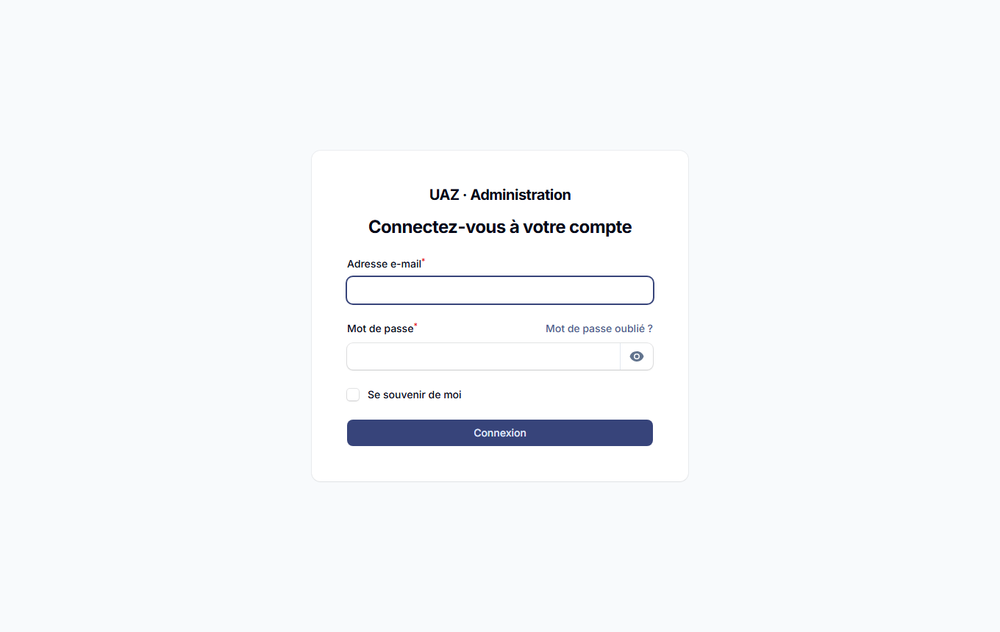

**Activer la double authentification (fortement recommandé).** Cliquez sur votre nom en haut à droite → *Profil* →
*Authentification à deux facteurs* → *Configurer*. Scannez le QR code avec une application (Google Authenticator,
Microsoft Authenticator, Aegis…), saisissez le code, puis **conservez les codes de secours** dans un endroit sûr.
Ensuite, chaque connexion demandera un code à 6 chiffres.

### Qui peut faire quoi ?

| Rôle | Peut… |
| --- | --- |
| **Contributeur** | écrire des **brouillons** et modifier **ses propres brouillons** ; envoyer des images. Il ne peut pas publier ni supprimer. |
| **Éditeur** | tout ce qui touche aux contenus : publier, programmer, modifier, supprimer ; gérer la médiathèque, les menus, les réglages ; lire les messages de contact. |
| **Super-administrateur** | tout, y compris les comptes utilisateurs. |

Un contributeur voit *« Seul un éditeur peut publier »* : son contenu reste en brouillon jusqu'à validation par un éditeur.

---

## 2. Découvrir l'écran

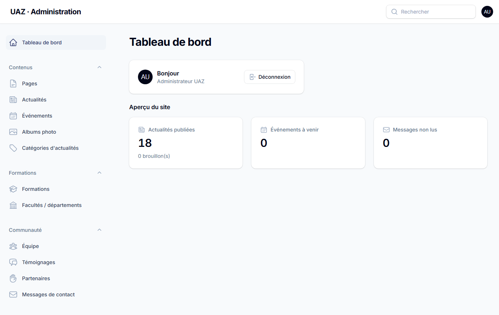

Le **menu à gauche** est organisé en rubriques :

- **Contenus** : Pages, Actualités, Événements, Albums photo, Catégories d'actualités
- **Formations** : Formations, Facultés / départements
- **Communauté** : Équipe, Témoignages, Partenaires, Messages de contact
- **Médias** : Médiathèque
- **Site** : Réglages du site, Menus, Redirections
- **Administration** : Utilisateurs *(super-administrateur)*

Chaque liste a une **barre de recherche**, des **filtres** (statut, catégorie…) et des boutons d'action
(*Modifier*, *Aperçu*, *Supprimer*). Le bouton **Aperçu** ouvre la page telle que les visiteurs la verront — même si elle est
encore en brouillon (seuls les comptes connectés voient les brouillons).

---

## 3. Envoyer des images (la médiathèque)

Toutes les images et tous les PDF passent par la **Médiathèque** : on les envoie une fois, puis on les réutilise partout.

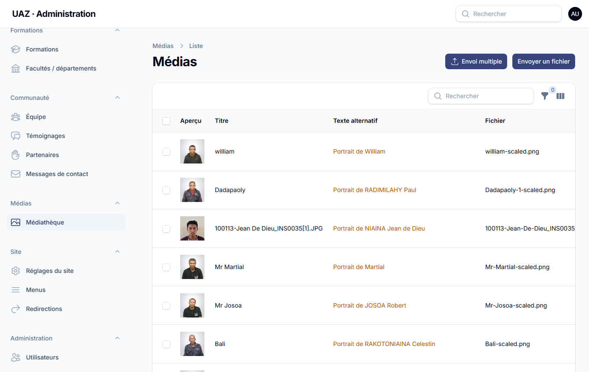

### Envoyer plusieurs images d'un coup

1. **Médias → Médiathèque → Envoi multiple**.
2. Déposez vos fichiers (30 au maximum à la fois).
3. Pour **chaque** fichier, décrivez l'image dans *Texte alternatif* (obligatoire).
4. Cliquez sur *Enregistrer dans la médiathèque*.

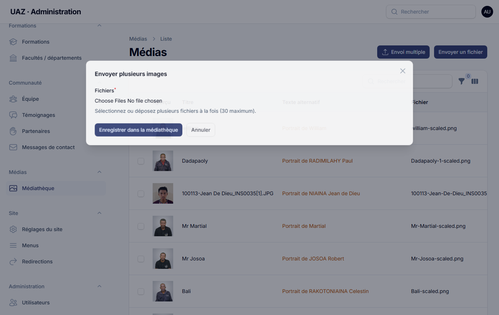

### Le texte alternatif, c'est quoi ?

Une phrase courte qui **décrit l'image** pour les personnes aveugles ou malvoyantes (lecteurs d'écran) et pour Google.
Il est **obligatoire**.

| ✅ Bon | ❌ À éviter |
| --- | --- |
| « Étudiants de première année devant la bibliothèque » | « IMG_6536 » |
| « Remise des diplômes de la promotion 2025 sur la pelouse du campus » | « photo » |

Pour un PDF, indiquez son sujet : « Calendrier académique 2026-2027 ».

### Règles pratiques

- Formats acceptés : **JPEG, PNG, WebP** et **PDF**. Taille maximale : **10 Mo** par fichier.
- Pas besoin de réduire vos photos : elles sont **compressées automatiquement** (taille maxi 2 560 px) et déclinées en
  plusieurs tailles (WebP/AVIF) pour que le site reste rapide sur mobile.
- Fichiers Word, Excel, vidéos : non acceptés. Convertissez en PDF.
- Le filtre **« Sans texte alternatif »** de la médiathèque liste les images à compléter.

---

## 4. Publier une actualité (pas à pas)

1. **Contenus → Actualités → Nouvelle actualité**.

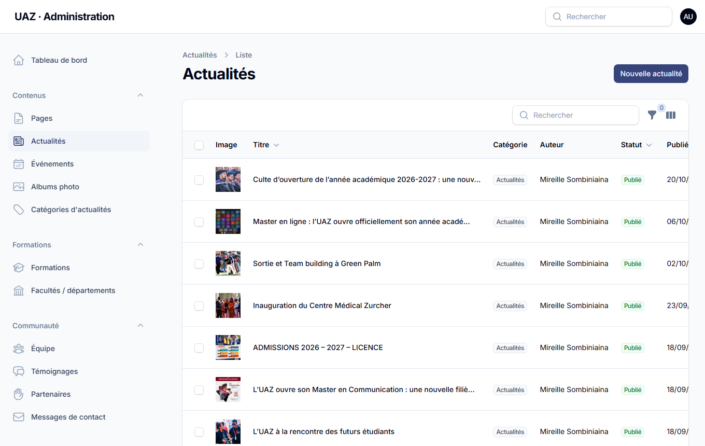

2. Remplissez :
   - **Titre** : clair et informatif (« Master en ligne : l'UAZ ouvre son année académique »).
   - **Extrait** : 1 à 2 phrases, affichées dans les listes et sur les réseaux sociaux.
   - **Image à la une** : cliquez sur le champ et **choisissez** une image de la médiathèque (recherche par titre), ou cliquez
     sur **« + »** pour **envoyer une nouvelle image** sans quitter la page (texte alternatif obligatoire).
   - **Texte** : l'éditeur propose gras, italique, titres (H2/H3), listes, citations et liens.
3. À droite :
   - **Catégorie** (créez-en une avec « + » si besoin) et **Auteur**.
   - **Mettre à la une** : l'article passe en tête de l'accueil.
   - **Statut** et **date de publication** (voir ci-dessous).
4. Cliquez sur **Créer**. Utilisez **Aperçu** pour vérifier le rendu.

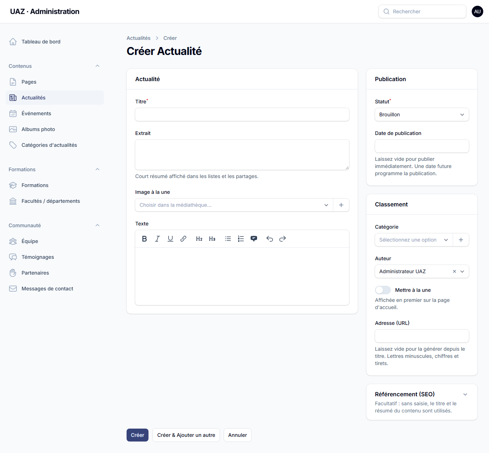

### Brouillon, publication immédiate, publication programmée

| Je veux… | Statut | Date de publication |
| --- | --- | --- |
| garder en brouillon | **Brouillon** | — |
| publier maintenant | **Publié** | laisser **vide** |
| publier plus tard | **Publié** | choisir la **date et l'heure** : l'article est « Programmé » et apparaît tout seul |

Dans la liste, un badge indique **Brouillon**, **Programmé** ou **Publié**.

### Conseils de rédaction

- Un seul sujet par article ; commencez par l'information la plus importante.
- Titres intermédiaires (H2) tous les 3-4 paragraphes : ils aident la lecture sur mobile.
- Liens : sélectionnez le texte (« conditions d'admission »), cliquez sur l'icône lien. Évitez « cliquez ici ».
- Images dans le texte : insérez-les via les **blocs** d'une page ; pour une actualité, l'image à la une suffit en général.
- Le **titre SEO** et la **description** (section « Référencement ») sont facultatifs : sans saisie, le titre et l'extrait sont utilisés.

---

## 5. Modifier une page

1. **Contenus → Pages**, cliquez sur **Modifier** à côté de la page.

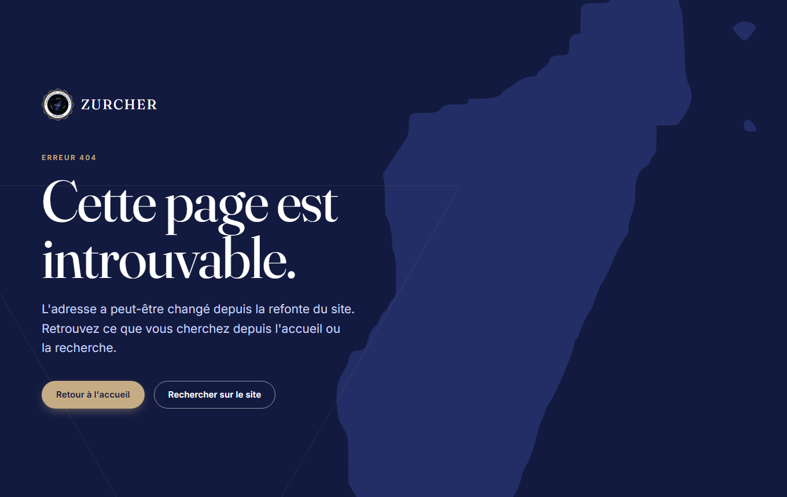

2. Le contenu est composé de **blocs** que vous pouvez ajouter, déplacer (flèches) et supprimer :

| Bloc | Usage |
| --- | --- |
| **Texte** | paragraphes, titres, listes, liens |
| **Image** | une image large avec légende |
| **Galerie** | plusieurs photos avec visionneuse |
| **Citation** | citation mise en valeur (témoignage, verset…) |
| **Appel à l'action** | bandeau avec bouton (« Candidater », « Nous contacter ») |
| **Chiffres clés** | 2 à 6 chiffres avec libellé |
| **Liste de cartes** | cartes titre + texte + image + lien (programmes, services…) |

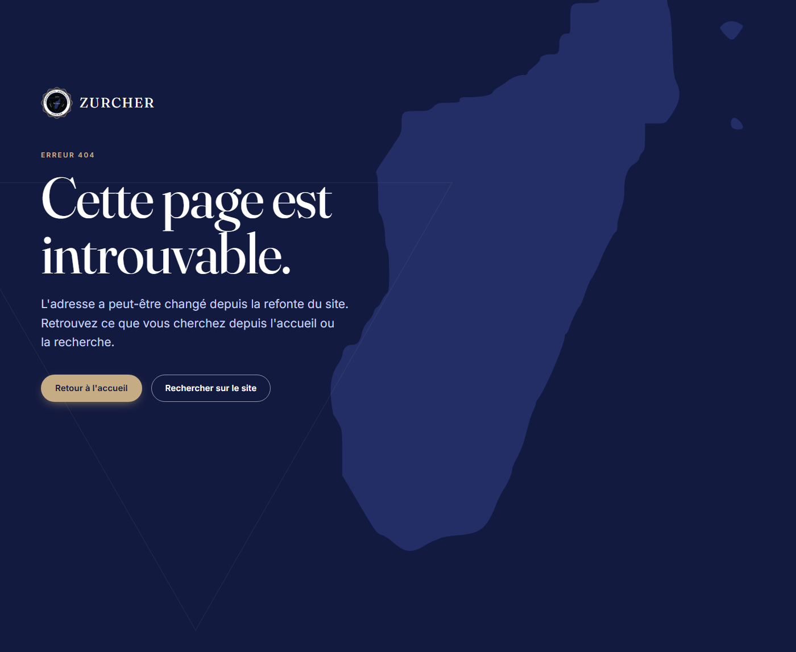

3. **Enregistrer**. Pensez à **Aperçu** avant d'annoncer la page.

Les pages « système » (À propos, Admissions, Vie étudiante…) ne peuvent pas être supprimées : modifiez leur contenu librement.
Pour créer une **sous-page**, choisissez une **page parente** (l'adresse devient `/admissions/licence`).

---

## 6. Les autres contenus

- **Événements** : titre, dates de début/fin, lieu, lien d'inscription. Ils passent automatiquement de « À venir » à « Passés ».
- **Formations** : onglets *Présentation*, *Débouchés*, *Admission* ; niveau (Licence, Master…), durée, crédits ECTS ;
  « Mettre en avant sur l'accueil » pour les cartes de la page d'accueil.
- **Équipe** : photo, fonction, e-mail (visible sur le site), ordre d'affichage par glisser-déposer. Désactivez *Affiché sur le site*
  plutôt que supprimer.
- **Témoignages** : citation et/ou vidéo YouTube ; seuls les témoignages *Affichés* apparaissent sur l'accueil.
- **Albums photo** : choisissez plusieurs photos d'un coup (« Ajouter plusieurs photos d'un coup ») puis ordonnez-les.
- **Partenaires** : logo + lien (affichés en bas de l'accueil).

---

## 7. Menus et réglages du site

**Site → Menus** : le menu principal (en-tête) et le menu du pied de page. Ajoutez un lien *vers une page du site* ou une
*adresse libre*, avec éventuellement un sous-menu.

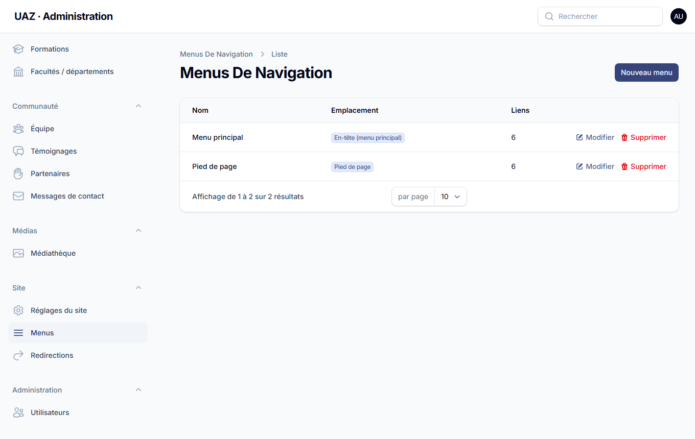

**Site → Réglages du site** : nom, slogan, logo, **coordonnées**, horaires, réseaux sociaux, **titre et image de l'accueil**,
**chiffres clés** de l'accueil (ne saisissez que des chiffres officiels), pied de page.

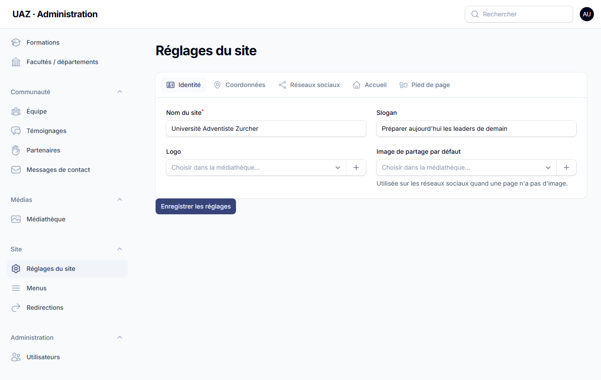

**Site → Redirections** : si vous renommez ou supprimez une page très visitée, ajoutez une redirection (ancienne adresse → nouvelle
adresse, type 301) pour que les anciens liens continuent de fonctionner.

---

## 8. Messages reçus par le formulaire de contact

**Communauté → Messages de contact** : liste des messages (une enveloppe pleine marque les messages non lus ; un badge indique leur nombre dans le menu).
Cliquez sur **Lire** pour ouvrir un message. Vous pouvez **exporter en CSV** (compatible Excel). Les messages ne sont pas modifiables.
Supprimez ceux dont vous n'avez plus besoin : ce sont des données personnelles.

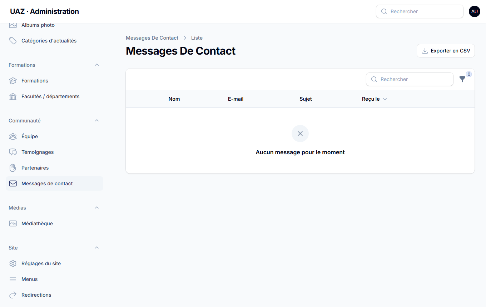

---

## 9. Bonnes pratiques et dépannage

- **Enregistrez** avant de quitter une page ; le navigateur prévient en cas de modification non enregistrée.
- **Je ne vois pas ma page sur le site** : vérifiez le statut (*Publié*) et la date de publication (pas dans le futur) ; videz le cache
  de votre navigateur (Ctrl+F5).
- **Mon image est refusée** : vérifiez le format (JPEG/PNG/WebP/PDF) et la taille (< 10 Mo).
- **Un lien est cassé** : ouvrez la page cible dans Pages et vérifiez son adresse ; ajoutez une redirection si besoin.
- **J'ai supprimé quelque chose par erreur** : prévenez rapidement l'administrateur, il existe des sauvegardes quotidiennes.
- **Mot de passe oublié** : « Mot de passe oublié ? » sur l'écran de connexion, ou demandez un nouveau mot de passe à l'administrateur.
- **Respect des personnes** : ne publiez ni photo ni information personnelle sans l'accord des personnes concernées.

## 10. Aide-mémoire

| Action | Où |
| --- | --- |
| Nouvelle actualité | Contenus → Actualités → Nouvelle actualité |
| Envoyer des images | Médias → Médiathèque → Envoi multiple |
| Modifier l'accueil (titre, chiffres, image) | Site → Réglages du site → Accueil |
| Modifier un texte de page | Contenus → Pages → Modifier |
| Ajouter un événement | Contenus → Événements → Nouvel événement |
| Lire les messages | Communauté → Messages de contact |
| Changer le menu | Site → Menus |
